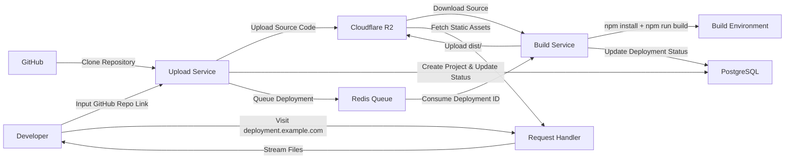
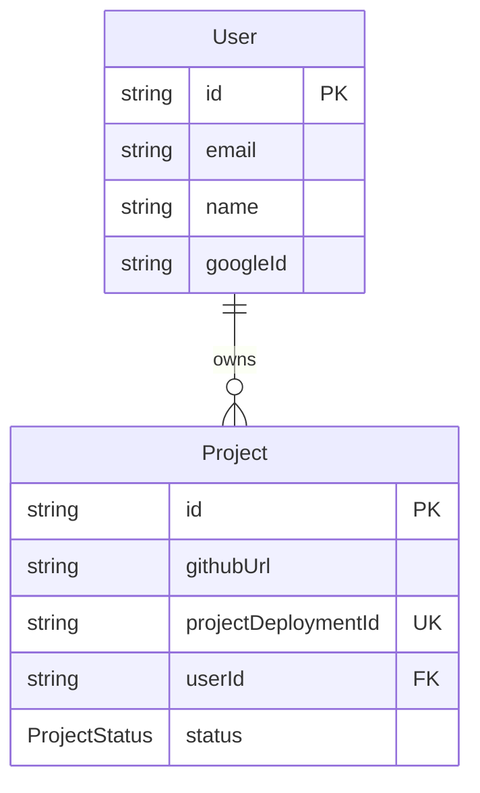
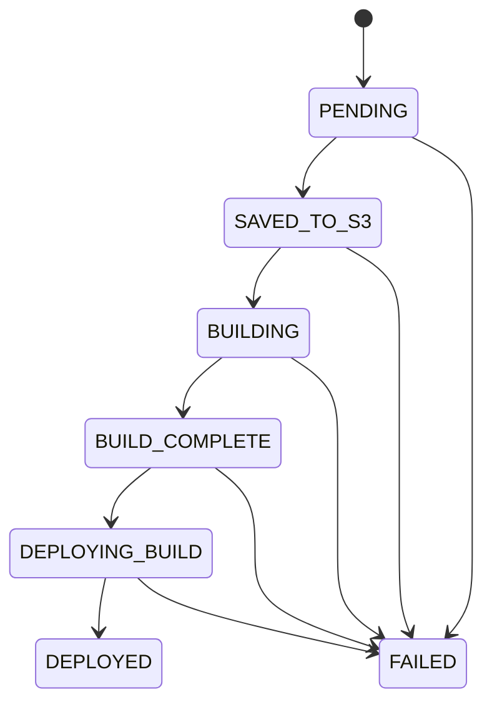
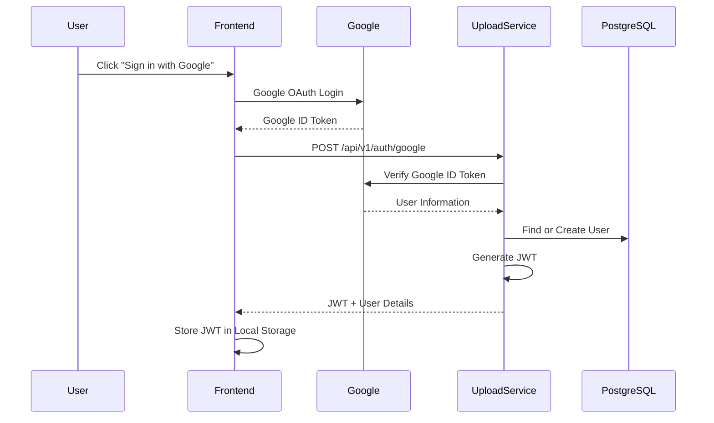
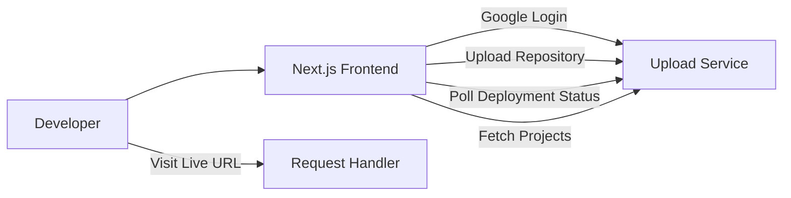
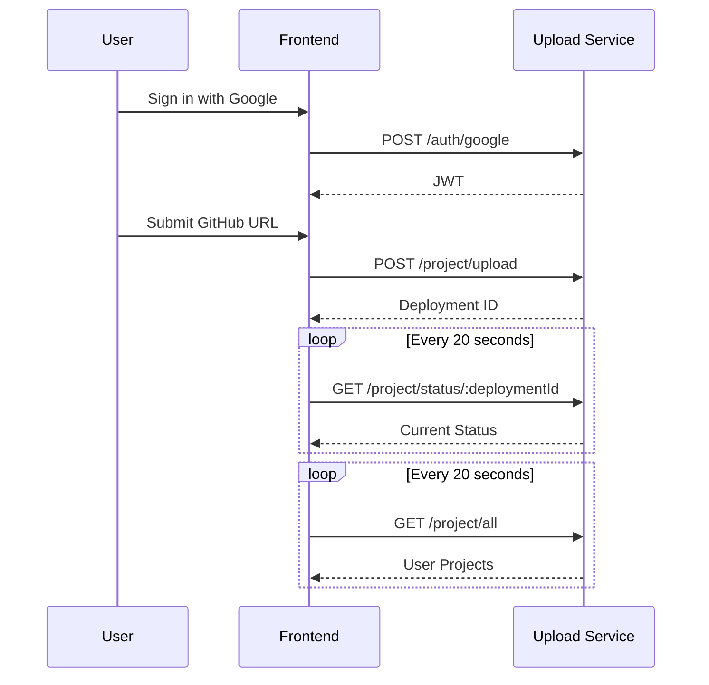

# Architecture

The project follows an event-driven microservice architecture inspired by Vercel's deployment pipeline. Each service has a single responsibility and communicates through Redis, PostgreSQL, and Cloudflare R2.



---

# Services

## Upload Service

Responsible for receiving deployment requests from authenticated users.

Responsibilities:

- Authenticate users using Google OAuth.
- Clone the submitted GitHub repository.
- Upload the repository source code to Cloudflare R2.
- Create a Project record in PostgreSQL.
- Push the deployment identifier into a Redis queue for asynchronous processing.

The Upload Service never performs the project build itself. Its responsibility ends once the source code has been stored and a deployment job has been queued.

---

## Build Service

Acts as a background worker.

It continuously listens to the Redis queue for pending deployment jobs.

For every deployment it:

1. Downloads the uploaded source code from Cloudflare R2.
2. Recreates the original project directory.
3. Executes

```bash
npm install
npm run build
```

4. Uploads the generated `dist/` folder back to Cloudflare R2.
5. Updates the deployment status inside PostgreSQL.

This service performs all CPU-intensive work separately from the API server.

---

## Request Handler

Responsible for serving deployed applications.

When a request arrives:

```
abc.localhost:3005/
```

the Request Handler:

1. Extracts the deployment identifier (`abc`) from the hostname.
2. Maps the requested path to

```
output/abc/dist/<requested-file>
```

3. Downloads the asset from Cloudflare R2.
4. Detects the correct MIME type.
5. Streams the file directly to the client.

The Request Handler does not store project files locally.

---

# Supporting Infrastructure

## PostgreSQL

Stores application metadata including:

- Users
- Projects
- Deployment status
- Repository URL
- Deployment identifier

Project lifecycle:

```text
PENDING
    ↓
SAVED_TO_S3
    ↓
BUILDING
    ↓
BUILD_COMPLETE
    ↓
DEPLOYING_BUILD
    ↓
DEPLOYED
```

or

```text
FAILED
```

---

## Redis

Redis is used as a deployment queue.

The Upload Service pushes deployment identifiers into a Redis List.

```
LPUSH PROJECT_IDS <deploymentId>
```

The Build Service blocks until work becomes available using

```
BRPOP PROJECT_IDS
```

This decouples the API layer from the build pipeline, allowing uploads to return immediately while builds are processed asynchronously.

---

## Cloudflare R2

Cloudflare R2 is used as the project's object storage.

Source code uploaded by the Upload Service is stored under:

```
input/
    <deploymentId>/
        ...
```

After the build completes, production assets are stored under:

```
output/
    <deploymentId>/
        dist/
            index.html
            assets/
            ...
```

The Request Handler serves files directly from the `output/` directory inside R2.

# Database Schema

The application stores user information and deployment metadata in PostgreSQL using Prisma ORM.

## Entity Relationship Diagram



---

## User

Represents an authenticated user.

| Field | Type | Description |
|------|------|-------------|
| id | UUID | Primary key |
| email | String | User email address |
| name | String | User's display name |
| googleId | String | Google OAuth unique identifier |
| projects | Relation | One-to-many relationship with Project |

---

## Project

Represents a deployment.

Each upload of a GitHub repository creates a new Project.

| Field | Type | Description |
|------|------|-------------|
| id | UUID | Primary key |
| githubUrl | String | Repository URL submitted by the user |
| projectDeploymentId | String | Public deployment identifier used in URLs |
| userId | UUID | Owner of the deployment |
| status | ProjectStatus | Current deployment state |

Example deployment URL

```
https://abc123.localhost:3005
```

where

```
projectDeploymentId = abc123
```

---

## Project Status Lifecycle



---

# API Endpoints

## Authentication

### POST `/api/v1/auth/google`

Authenticates a user using a Google OAuth credential.

#### Request

```json
{
  "token": "<google-id-token>"
}
```

#### Success Response

```json
{
  "token": "<jwt>",
  "user": {
    "id": "...",
    "email": "...",
    "name": "...",
    "image": "..."
  }
}
```

---

## Projects

All project endpoints require

```
Authorization: Bearer <jwt>
```

---

### POST `/api/v1/project/upload`

Creates a new deployment.

#### Request

```json
{
  "projectUrl": "https://github.com/user/repository"
}
```

#### Success Response

```json
{
  "projectDeploymentId": "abc123"
}
```

#### Workflow

1. Clone GitHub repository.
2. Upload source files to Cloudflare R2.
3. Create Project record.
4. Push deployment ID into Redis queue.
5. Return immediately.

---

### GET `/api/v1/project/all`

Returns every deployment belonging to the authenticated user.

#### Response

```json
{
  "projects": [
    {
      "id": "...",
      "githubUrl": "...",
      "projectDeploymentId": "abc123",
      "status": "DEPLOYED"
    }
  ]
}
```

---

### GET `/api/v1/project/status/:projectDeploymentId`

Returns the latest deployment status.

#### Example

```
GET /api/v1/project/status/abc123
```

#### Response

```json
{
  "status": "BUILDING"
}
```

The frontend performs **short polling every 20 seconds** against this endpoint to update deployment progress.

---

# Request Handler

The Request Handler serves deployed applications.

Unlike the Upload Service, these endpoints are **public** and do not require authentication.

---

### GET `/{*}`

Catch-all route responsible for serving static assets.

Example requests

```
GET /
GET /assets/index.js
GET /assets/index.css
GET /favicon.ico
```

The Request Handler:

1. Extracts the deployment identifier from the request hostname.
2. Maps the request path to the corresponding object in Cloudflare R2.
3. Detects the appropriate MIME type.
4. Streams the asset directly to the client.

Example

```
Host:
abc123.localhost:3005

Request:
GET /

↓

Cloudflare R2

output/
    abc123/
        dist/
            index.html
```

Static assets are streamed directly from Cloudflare R2 without being stored on the Request Handler.

# Authentication

Authentication is implemented using **Google OAuth 2.0**, **JWT**, and a custom authentication middleware.

The frontend authenticates users with Google Identity Services, while the backend verifies the received Google ID Token before issuing its own JWT for subsequent API requests.

---

## Authentication Flow



---

## Google OAuth

The frontend integrates **Google Identity Services** to authenticate users.

After a successful login, Google returns an **ID Token**, which is sent to the backend for verification.

The backend does **not** trust the frontend directly. Every received Google token is verified against Google's authentication service before creating a session.

---

## JWT Authentication

After verifying the Google ID Token, the Upload Service generates its own JWT.

This JWT is returned to the frontend and is used to authenticate all protected API requests.

Example:

```http
Authorization: Bearer <jwt>
```

The backend validates this token on every authenticated request before allowing access to protected resources.

---

## User Registration

Authentication also serves as user registration.

After successfully verifying the Google account:

- If the user already exists, the existing account is returned.
- Otherwise, a new user record is created in PostgreSQL.

This allows authentication and account creation to happen in a single request.

---

## Session Management

The frontend stores the authenticated session in the browser using Local Storage.

The stored session contains:

- JWT
- User ID
- Name
- Email
- Profile Image (if available)

When the application loads, the session is restored from Local Storage so users remain signed in until they explicitly log out.

---

## Protected Routes

The following endpoints require a valid JWT.

| Endpoint | Authentication |
|-----------|---------------|
| POST `/api/v1/project/upload` | ✅ |
| GET `/api/v1/project/all` | ✅ |
| GET `/api/v1/project/status/:projectDeploymentId` | ✅ |

Authentication middleware:

1. Reads the `Authorization` header.
2. Extracts the Bearer token.
3. Verifies the JWT.
4. Retrieves the authenticated user's identity.
5. Attaches the user ID to the request object.
6. Passes control to the protected route.

If the token is invalid or missing, the request is rejected with an authentication error.

---

## Logout

Logging out is handled entirely on the client.

The frontend clears the stored JWT and user information from Local Storage, after which protected pages redirect unauthenticated users back to the landing page.

---

## Security Considerations

- Google ID Tokens are always verified by the backend before issuing a JWT.
- Passwords are never stored or managed by the application.
- Only the backend generates and signs JWTs.
- All project-related endpoints require authentication.
- Every project is associated with its owner (`userId`), ensuring users can only access their own deployments.


# Frontend

The frontend is built using **Next.js** and serves as the primary interface for authentication, project deployment, deployment monitoring, and project management.

It communicates exclusively with the **Upload Service** through authenticated REST APIs and generates deployment URLs for projects served by the Request Handler.

---

## Responsibilities

The frontend is responsible for:

- User authentication using Google OAuth
- Session management
- Publishing GitHub repositories
- Monitoring deployment progress
- Displaying deployment history
- Opening deployed applications
- Providing project details

The frontend does **not** participate in cloning repositories, building projects, or serving static files.

---

# Frontend Architecture



---

# Landing Page

The landing page acts as the project's public entry point.

It includes:

- Product introduction
- Feature highlights
- Three.js animated hero section
- Google Sign-In
- Theme toggle
- Responsive design

Unauthenticated users begin the deployment process by signing in with Google.

---

# Authentication

Authentication is handled using **Google Identity Services**.

After a successful login:

1. Google returns an ID Token.
2. The frontend sends the credential to the Upload Service.
3. The Upload Service verifies the token.
4. A JWT and user information are returned.
5. The frontend stores the session locally.

After authentication the user is redirected to the workspace.

---

# Session Management

The authenticated session is stored in Local Storage.

Stored information includes:

- JWT
- User ID
- Name
- Email
- Profile Image

The application restores the session automatically whenever the user revisits the application.

Protected pages redirect unauthenticated users back to the landing page.

---

# Workspace

The workspace is the primary dashboard after authentication.

Users can:

- Submit a public GitHub repository
- Monitor deployment progress
- View deployment history
- Open deployed applications
- Navigate to project details

---

# Publishing a Project

When the user submits a GitHub repository:

```text
User
    │
    ▼
Enter Repository URL
    │
    ▼
POST /project/upload
    │
    ▼
Receive Deployment ID
    │
    ▼
Begin Status Polling
```

The frontend immediately receives a deployment identifier without waiting for the build to complete.

---

# Deployment Monitoring

Deployment progress is monitored using **short polling**.

Every **20 seconds** the frontend requests the latest deployment status from the Upload Service.

```
GET /project/status/:projectDeploymentId
```

Deployment states displayed to the user are:

```
PENDING
↓

SAVED_TO_S3
↓

BUILDING
↓

BUILD_COMPLETE
↓

DEPLOYING_BUILD
↓

DEPLOYED
```

or

```
FAILED
```

Each status is represented by its own UI state and descriptive message.

---

# Project List

The workspace periodically fetches the authenticated user's projects.

```
GET /project/all
```

This request is also performed every **20 seconds** to keep the deployment list synchronized with the backend.

Each project card displays:

- Repository URL
- Deployment ID
- Current deployment status
- Link to Project Details
- Live deployment URL (once deployed)

---

# Project Details

Each deployment has its own details page.

The page displays:

- Deployment ID
- Repository URL
- Current deployment status
- Deployment description
- Live deployment URL (when available)

The page continues polling the backend every **20 seconds** until the deployment reaches its final state.

---

# Live Deployment URLs

Once a deployment reaches the `DEPLOYED` state, the frontend generates its public URL by prepending the deployment identifier as a subdomain of the Request Handler.

Example:

```
Request Handler

localhost:3005
```

↓

Deployment

```
abc123.localhost:3005
```

Selecting **Open Live Site** opens the deployed application served by the Request Handler.

---

# Theme Support

The frontend supports both light and dark themes.

The selected theme is persisted in Local Storage and restored automatically on subsequent visits.

---

# Frontend Routing

| Route | Description |
|--------|-------------|
| `/` | Landing page and Google Sign-In |
| `/app` | User workspace |
| `/app/[projectDeploymentId]` | Deployment details |

---

# Communication with Backend



